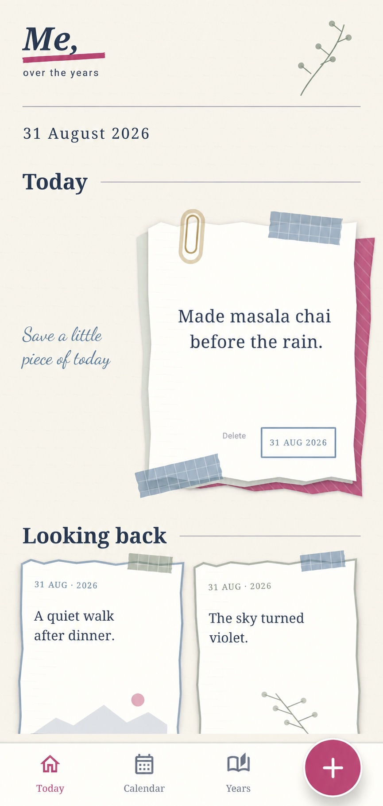
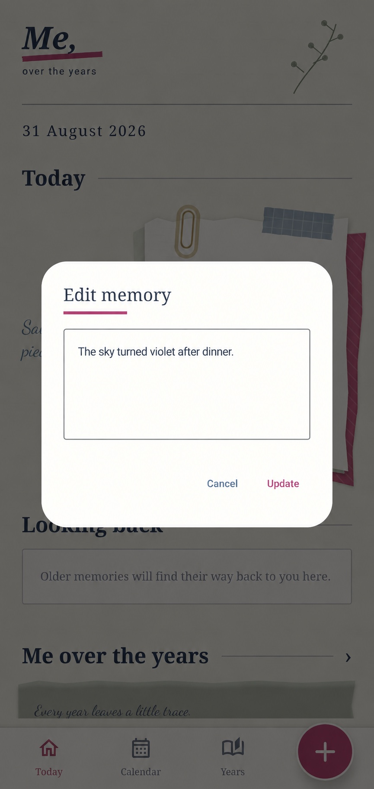

# Me, over the years

A private Android memory album for an audience of one: a quick place to save the little moments that are too small for a diary and too personal, ordinary, or precious to publish.

  
  

*Sanitized v0.3 device captures using synthetic memory text. The current product is text-only: it cannot attach images, video, or audio. See [the visual product notes](./VISUAL_PRODUCT.md).*

## The product belief

A memory does not need an audience to be worth keeping.

Most diary products begin with writing and storage. Me, over the years begins with return: save a small moment now, then meet it again on the same date months or years later. The app uses a tactile album metaphor so browsing feels like opening kept pages rather than managing a database.

## What I built

- Fast text-memory capture with an automatic date and time
- Today, calendar, and year-based ways to revisit entries
- A “this day, over the years” view for memories on the same calendar date
- An offline local SQLite store encrypted with SQLCipher, with no account or app-owned memory backend
- Manual export and non-destructive restore, including duplicate protection
- Permanently signed Android builds so updates can install without deleting local memories
- A warm, Japanese-stationery-inspired album interface built with Jetpack Compose

The product has moved through several real-device iterations: from a plain offline text diary, to a scrapbook foundation, to safer backup and update handling, and then to a more tactile memory-page stack, calendar, and year selector.

## Product rules

- One person, not a social network
- Android and offline-first
- No account, login, ads, paid AI API, or app-owned memory database
- Test-build usage and crash reporting is disclosed separately from memory storage
- Core memories remain on the device
- Sharing, if added, must be deliberate
- The interface should feel tactile and personal without competing with the user's words

## The privacy model

The private source reviewed on 22 October 2026 identifies version **0.4.2**.
Capture and browsing work offline. Memories live in a SQLCipher-encrypted SQLite
database whose key is protected by Android Keystore. The v0.3 images above remain
historical, sanitized examples.

The test build requests internet permission for usage and crash reports. Reports are sent only when a nonempty reporting key is configured and the
first-launch notice has been accepted. The reviewed v0.4.2 source has no in-app
off switch after acceptance; this does not mean an unconfigured build sends reports. Events cover usage and failures, and the provider derives an
approximate location from the network address. Memory text is excluded. A tester
can optionally add their name to reports. Local memory storage does not mean the
test build makes no network requests.

Manual JSON backups remain readable plaintext and must be kept private. Export
and restore have an 8 MiB limit. Android automatic backup and phone transfer are
disabled. Uninstalling or losing the phone removes memories that are not in an
exported backup. Encrypted portable backup remains planned work.

## What I learned

For a private memory product, durability is part of the emotional experience. A beautiful capture flow is not enough if an update, uninstall, or lost signing key can separate someone from their memories. Backup, restore, stable signing, duplicate protection, and honest warnings therefore became product work, not supporting infrastructure.

The second lesson was visual: the album metaphor works only when it shapes interaction. Page stacks, date-based browsing, and returning to the same day across years matter more than decorative scrapbook elements on top of a generic feed.

## Current direction

The next priorities are editable or backdated memory dates, encrypted versioned backup, and refined resurfacing rules. After that safety foundation, media is planned in separate releases: user-selected photos first, then short video in a later version. Automatic public sharing, social mechanics, and a cloud backend are deliberately out of scope.

## What this repository is

A public case study, visual product history, and system architecture. See `VISUAL_PRODUCT.md` and `ARCHITECTURE.md`.

The Android source, private product diary, device screenshots containing personal memories, backup files, signing material, and all memory data stay private. No application code is published here.

## Who built it

Yashasvi Shailly. Designed, built, tested, and used as a personal product.
